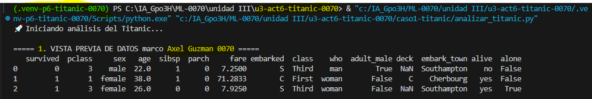
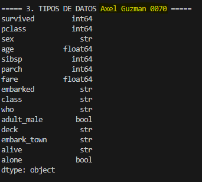
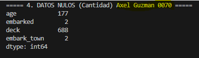
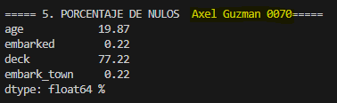
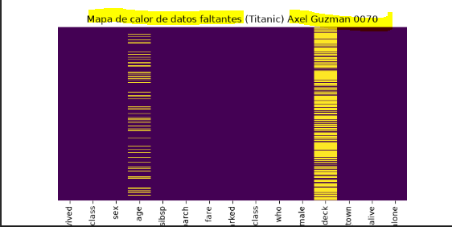

# Axel Guzman 0070
## 3. Caso 1: Identificación de problemas (Titanic)

## 1. VISTA PREVIA DE DATOS

## 2. DIMENSIONES

## 3. TIPOS DE DATOS

## 4. DATOS NULOS (Cantidad)

## 5. PORCENTAJE DE NULOS

## 6. REGISTROS DUPLICADOS

## 7. VALORES ATÍPICOS EN 'AGE'

## 8. mapa de calor
